<div align="center">

# qadam.

### Take it one step at a time.

**A safe place for parents and grandparents to learn banking, video calls, forms and scam-spotting by doing, not just watching.**


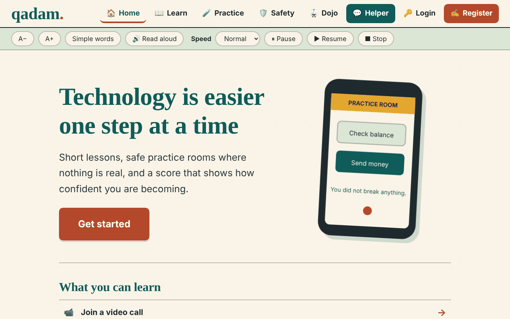

</div>

> *qadam* (قدم) is Urdu for **"step"**.
> Built for the **Build4Better Hackathon (Codesphere 3.0)**, organised by the Department of Software Engineering, NED University of Engineering and Technology.

---

## The problem

Many of our parents and grandparents avoid banking apps, video calls and online forms. The reason is rarely a lack of intelligence. They are afraid of **breaking something**, **looking foolish**, or **being scammed**, and that last fear is justified: fake bank messages, OTP theft and "your relative needs money now" scams target exactly these people.

Video tutorials show someone else doing the task. Chatbots do the task *for* you. Neither builds the thing that is actually missing: **confidence**.

## Our idea: learn by doing, in a place where nothing is real

qadam. gives people a complete, calm path from "I'm scared to tap anything" to "I can do this myself".

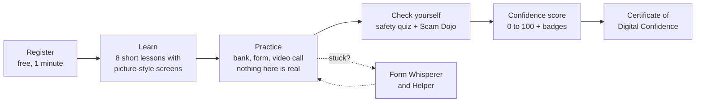

**What makes it different from an ordinary tutorial site**

| | Typical tutorial / YouTube / chatbot | **qadam.** |
|---|---|---|
| How people learn | Watch, or be told the answer | **Click, make mistakes, recover** |
| Mistakes | Cost something | **Met with kindness; Undo and "I'm stuck" always available** |
| Scams | A list of tips | **A hands-on Dojo: read a real-looking message, decide, then see *why*** |
| Progress | None | **Confidence score, badges and a printable certificate** |
| Language | English only | **Plain English, a "Simple words" mode, and Roman Urdu explanations** |
| Trust | "Trust the AI" | **Honest labels: practice rooms are simulations; the Helper is a built-in guide, not a live AI** |

---

## Feature tour

### 1. Lessons with picture-style screens
Eight short lessons (4 to 6 steps each): video calls, banking safely, spotting scam messages, WhatsApp messages and calls, normal phone calls, online forms, and strong passwords.
Every step shows **a mock phone screen with the exact thing to tap highlighted**, plus a one-line tip. Screens are generic and carry no real brand's logo.

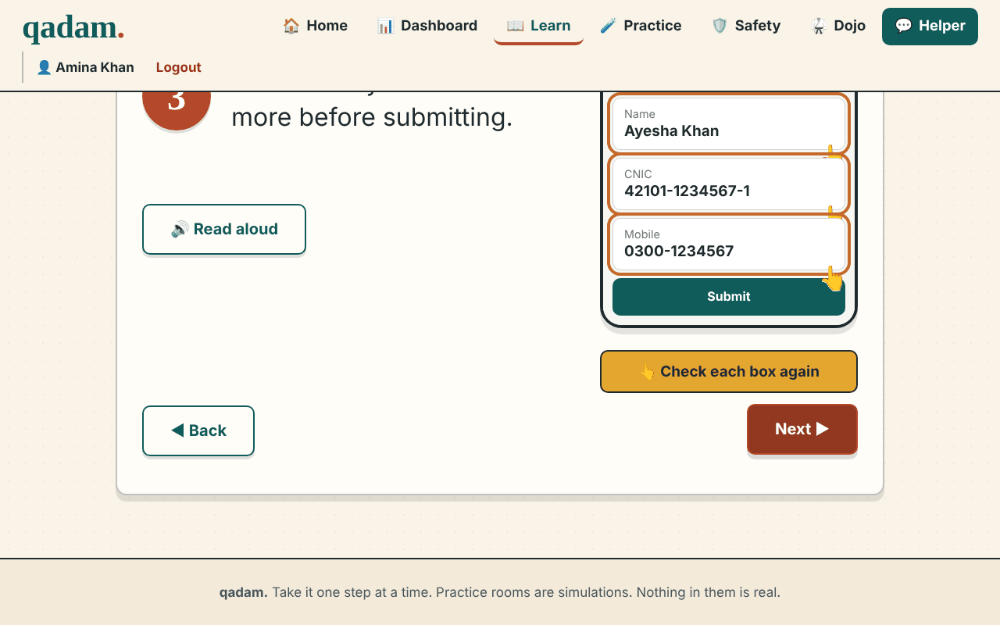

- One small step per screen, with Back / Next and a progress dots row
- **Simple words** mode rewrites every step in shorter language
- **Read aloud** on every step

### 2. Practice rooms: make mistakes safely
Three simulated rooms with a **coach panel** that always says *what to do now*. A wrong tap never scolds; it explains. **"I'm stuck"** reveals a hint.

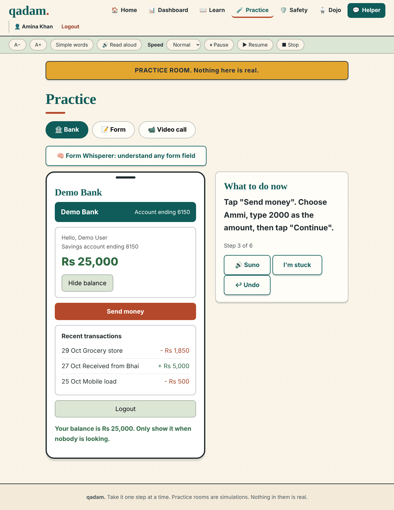

- **Bank sandbox:** a working demo bank (fictional balance, PIN, beneficiaries). Log in, show the balance, send money to a family member, confirm the name, enter the 6-digit SMS code, log out. **Undo** steps back, and the app reminds the user that real banks usually cannot reverse a payment, so check the name first.
- **Form room:** type a name and phone number, review, submit once.
- **Video call rehearsal:** uses the browser's **real camera and microphone permission**, shows a live self-preview and genuinely mutes and unmutes the mic. If there is no camera, the page is not secure, or permission is blocked, it falls back to a simulation and shows how to allow access.
- Rooms can be opened directly, for example `/practice#bank`. Finishing a room is saved to the learner's progress.

### 3. Form Whisperer: "what does *domicile* mean?"
Government and bank forms are full of words nobody explained. Type any field name and qadam. explains it in **simple English and Roman Urdu**, shows how to write it, then lets you **practise the answer** and checks it.

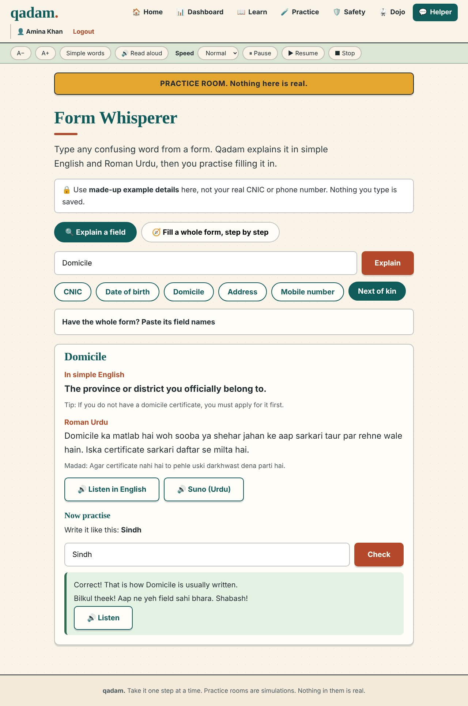

- Recognises **15 common fields** (CNIC, date of birth, domicile, father/guardian name, address, next of kin and more), tolerating typos and different wording
- **Paste a whole form's field names** and it finds the ones it knows and puts them in order
- **Guided mode:** walk through a complete form one field at a time (two ready-made forms: *Open a bank account* and *Pension or government application*)
- Validates practice answers with specific feedback, for example a CNIC must be 13 digits, and dates are checked for day-month-year order
- Reminds users to use **made-up details**; nothing typed here is saved

### 4. Scam Dojo: train your eye
A WhatsApp or SMS message appears. Is it real or a scam? The answer is hidden. Press **Real or Scam?** and the Dojo reveals the verdict and **highlights the exact phrases**: red flags in red, reassuring signs in green, each with a reason. Then it gives a plain **"Seedhi baat"** (the plain truth) and **"Kya karein"** (what to do), which can be read aloud.

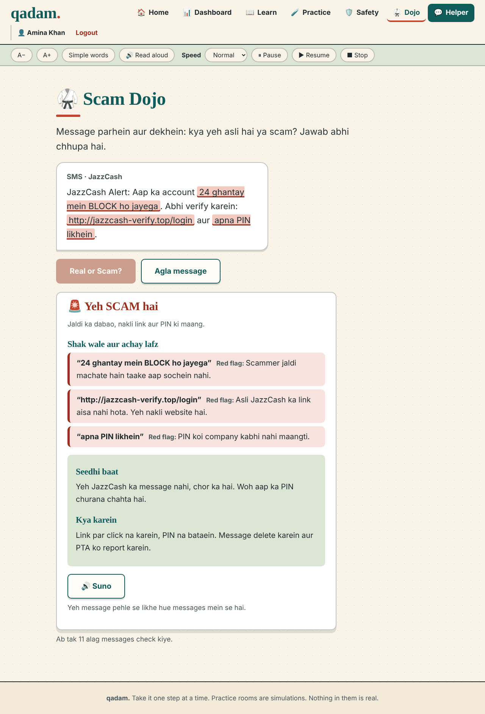

- About **65% of messages are scams**, the rest genuine, so learners do not simply learn "always say scam"
- **Answers never reach the browser early:** the server keeps the verdict and sends only the message and a one-time token. The answer is released when the learner presses the button.
- **Optional Gemini integration** generates a fresh message every time across 9 scam topics (fake JazzCash/Easypaisa blocks, fake BISP prizes, OTP requests, courier-fee links, "your son has a new number"...) and 6 genuine topics. Every generated message is **validated** (the highlighted phrases must really appear in the text, scams need at least one red flag, genuine messages only green) and rejected if it fails.
- **No API key? It still works.** A built-in set of 11 hand-written messages (6 scam, 5 genuine) plus anything the admin adds takes over automatically.

### 5. Safety quiz
Five realistic messages (fake bank SMS, prize link, OTP request, a "cousin with a new number") with **instant feedback and the reason**, a score, and retry. The admin can add more questions.

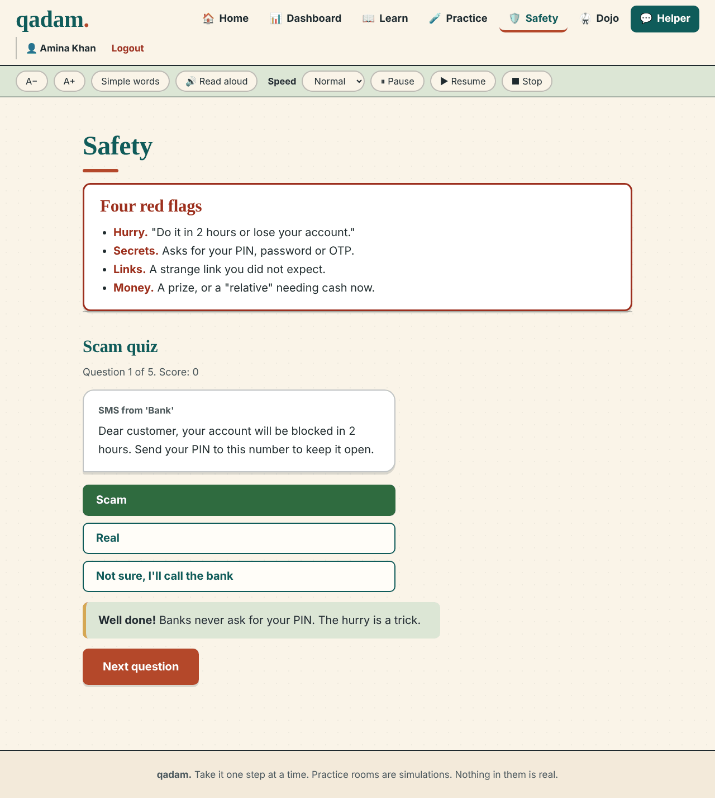

### 6. Helper
Type a question such as *"What is an OTP?"* and get a **short answer, the same in simple words, and a safe next step**. Suggested questions are one tap away. It is a **built-in keyword guide, and says so on screen**; it does not pretend to be a live AI.

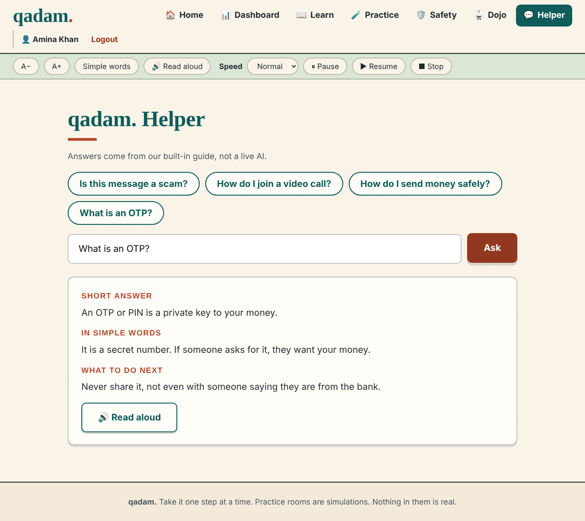

### 7. Dashboard and Digital Confidence Score
Everything a learner has done, on one calm page: lessons, practice rooms, best quiz score, Dojo checks, the next recommended step and badges.

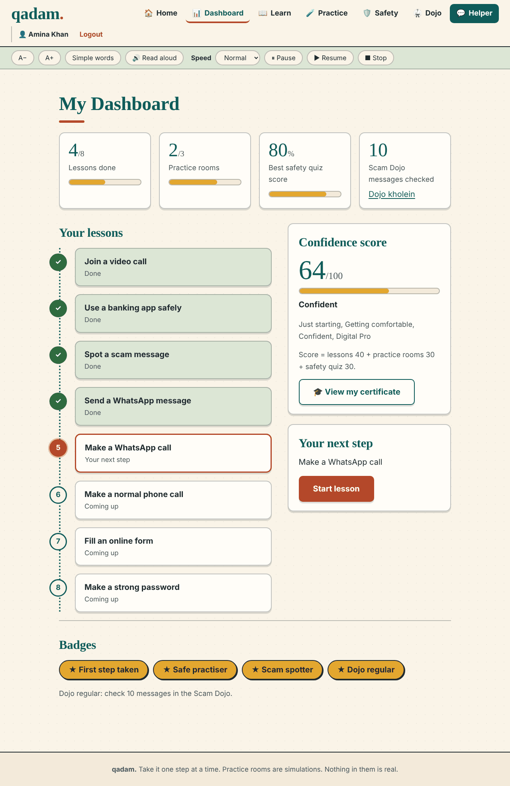

**Confidence score (0 to 100)** = lessons **40** + practice rooms **30** + safety quiz **30**

| Score | Level |
|---|---|
| 0-24 | Just starting |
| 25-49 | Getting comfortable |
| 50-79 | Confident |
| 80-100 | Digital Pro |

**Badges:** First step taken · Safe practiser · All lessons done · Scam spotter (quiz 80%+) · Dojo regular (10 Dojo checks)

### 8. Certificate of Digital Confidence
A printable certificate with the learner's name, level, stats, badges and a unique certificate number. **Print or save as PDF** in one click. A small thing that makes a grandparent proud.

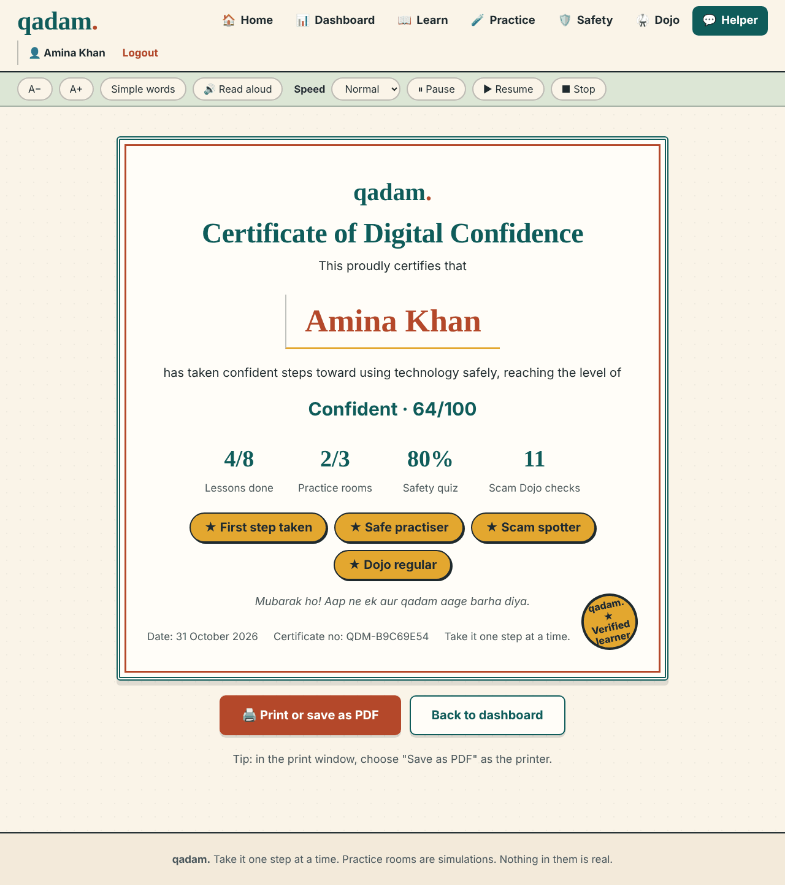

### 9. Accounts and admin
- **Register / log in** with name, email and password; progress is saved to the account, so it follows the learner to **any device**.
- **Admin area** (`/admin`): overview statistics, every learner and their progress, and the ability to **add or delete Safety-quiz questions and Scam Dojo messages**, with validation.

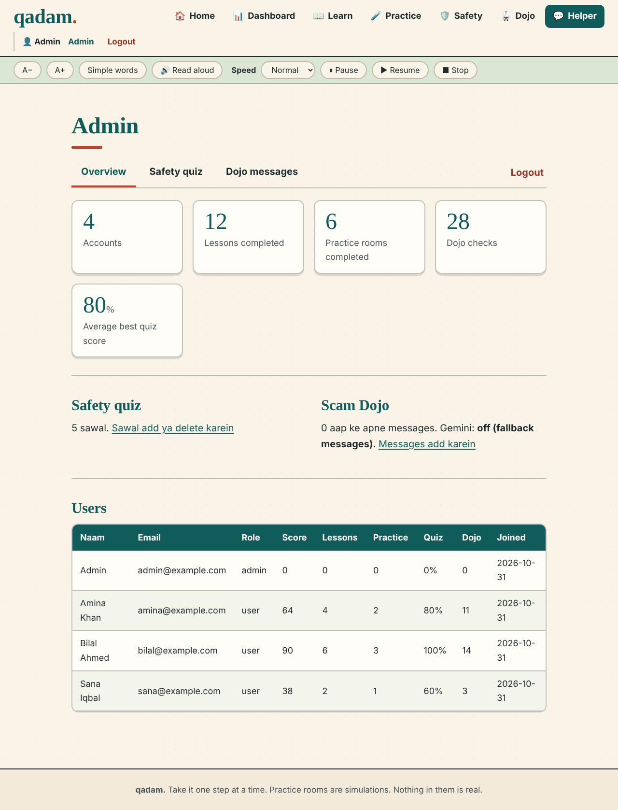

### 10. Built for older eyes, hands and phones
- **A− / A+** text size (16 to 28 px), saved between visits
- **Simple words** mode on lessons and key pages
- **Read aloud** for pages and steps, with **speed, pause, resume and stop** controls
- Large tap targets (56 px), visible keyboard focus and reduced-motion support
- **WCAG AA contrast** on the main colour pairs (measured: body text 13.4:1, teal headings 7.1:1, white on terracotta buttons 5.4:1)
- Fully responsive with a **bottom navigation bar on phones**

<table>
<tr>
<td align="center">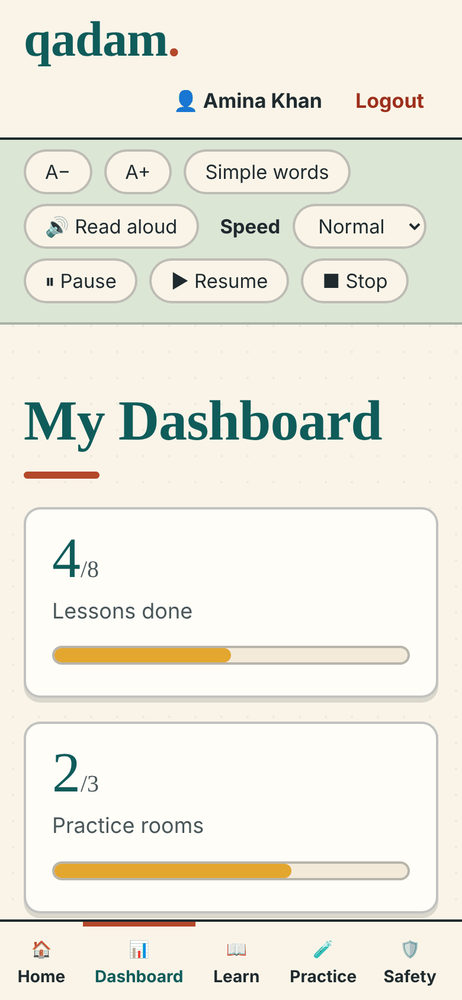</td>
<td align="center">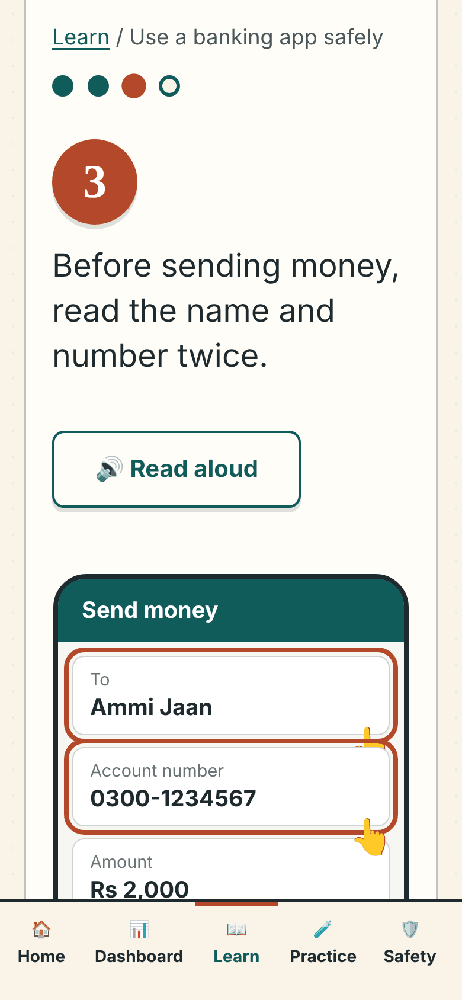</td>
<td align="center">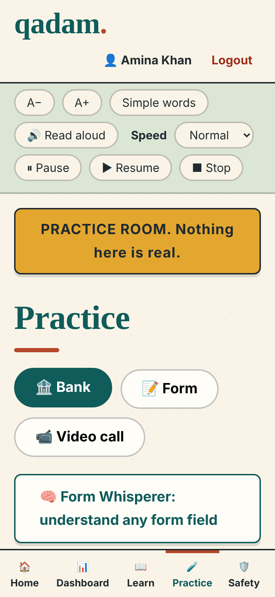</td>
</tr>
</table>

---

## Design

An intentionally **warm, editorial** look instead of the usual blue SaaS template: cream paper, deep teal ink, terracotta for actions and saffron for encouragement. The goal is calm, human and trustworthy.

| Role | Colour |
|---|---|
| Paper (background) | `#FAF4E8` |
| Ink (text) | `#1F2A2E` |
| Teal (brand) | `#0F5C5A` |
| Terracotta (actions) | `#B4482A` |
| Saffron (highlights) | `#E3A72F` |
| Sage (soft panels) | `#DCE6D5` |

**Type:** *Fraunces* (a friendly serif) for headings and *Atkinson Hyperlegible* (designed by the Braille Institute for maximum letter clarity) for body text.

---

## Under the hood

Deliberately simple, so a beginner can read every file: **no React, no Node, no build step.**

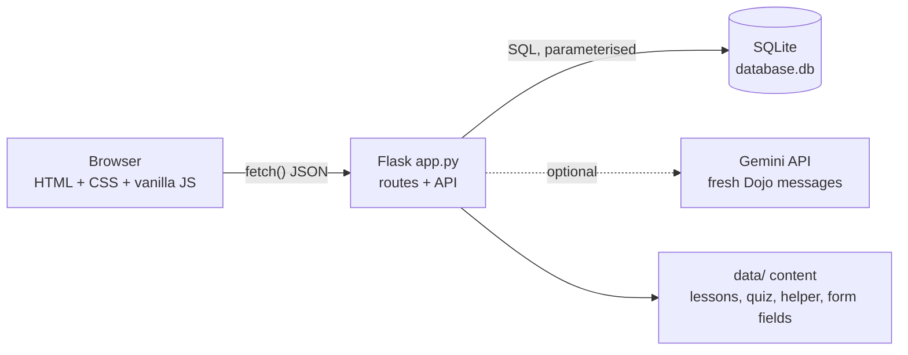

| Layer | Technology |
|---|---|
| Frontend | HTML5, CSS3, vanilla JavaScript (no frameworks) |
| Backend | Python, Flask 3 (one Blueprint for Form Whisperer) |
| Database | SQLite |
| Optional AI | Google Gemini over plain HTTPS (no SDK); the app works without it |
| Speech | Browser Web Speech API for read aloud; camera and mic via `getUserMedia` |

### Project structure

```
.
├── app.py                 Routes, API, accounts, admin, security checks
├── database.py            The only file that talks to SQLite
├── form_whisperer.py      Form Whisperer blueprint: recognise, scan, validate
├── requirements.txt
├── .env.example           Settings template (copy to .env)
├── data/
│   ├── tutorials.py       8 lessons: text, simple text, mock screen, highlight, tip
│   ├── quiz.py            Built-in safety-quiz questions
│   ├── knowledge_base.py  Helper answers (keyword matching)
│   ├── form_fields.py     Form Whisperer fields, hints, presets, error messages
│   ├── dojo.py            Scam Dojo engine: pick, Gemini call, validate, reveal
│   └── scam_fallback.py   11 offline Dojo messages (6 scam, 5 genuine)
├── templates/             Jinja pages (+ admin/)
└── static/
    ├── css/               style.css, lessons.css
    └── js/                script.js (shared), tutorial.js, screens.js, practice.js,
                           form_whisperer.js, dojo.js, quiz.js, assistant.js,
                           voice.js (voice navigation, experimental, not switched on yet)
```

### Main routes

| Route | Purpose |
|---|---|
| `/` | Landing page (public) |
| `/register`, `/login`, `POST /logout` | Accounts |
| `/path` | Dashboard |
| `/learn`, `/learn/<lesson>` | Lessons |
| `/practice`, `/practice#bank` | Practice rooms |
| `/form-whisperer` | Form Whisperer |
| `/dojo` | Scam Dojo |
| `/safety` | Red flags + scam quiz |
| `/assistant` | Helper |
| `/certificate` | Printable certificate |
| `/admin`, `/admin/quiz`, `/admin/dojo` | Admin only |
| `GET/POST /api/progress` | Save and read progress |
| `POST /api/assistant` | Helper answers |
| `GET /api/dojo/next`, `POST /api/dojo/check` | Dojo message and reveal |
| `/api/form-whisperer`, `/scan`, `/presets`, `/check` | Form Whisperer |

---

## Security and privacy

Built with care because the audience is exactly who scammers target.

- **Passwords are hashed** (Werkzeug); plain passwords are never stored
- **CSRF tokens** on every HTML form (login, register, logout and all admin actions)
- **Login throttling:** 5 wrong attempts, then a 5-minute pause; a dummy hash check keeps response timing similar for unknown emails
- **Open-redirect protection** on the `next` link after login
- **Role-based access:** only `admin` users can open `/admin`; everything except Home, Login and Register requires an account
- **User input always goes through parameterised SQL queries**; text shown on pages is escaped or set with `textContent`, never injected as raw HTML
- **Dojo answers stay on the server** until the learner asks for them
- Secrets live in `.env`, which `.gitignore` keeps out of Git
- The simulated bank and form use **fictional data only**; the app never asks for real banking details, and Form Whisperer asks users to type made-up examples

---

## Run it yourself

**Requirements:** Python 3.9 or newer.

**Windows (PowerShell):**
```powershell
python -m venv venv
venv\Scripts\Activate.ps1
pip install -r requirements.txt
python app.py
```

**macOS / Linux:**
```bash
python3 -m venv venv
source venv/bin/activate
pip install -r requirements.txt
python app.py
```

Open **http://127.0.0.1:5000** and press **Register**.

### Optional settings
Copy `.env.example` to `.env` and edit it:

| Setting | What it does |
|---|---|
| `GEMINI_API_KEY` | Turns on fresh AI-generated Scam Dojo messages. Leave empty to use the offline messages. |
| `GEMINI_MODEL` | Model name (default `gemini-2.5-flash`) |
| `ADMIN_EMAIL` / `ADMIN_PASSWORD` | The first admin account. **Always set your own `ADMIN_PASSWORD`;** without it a testing-only default account is created. |
| `SECRET_KEY` | A long random string used to sign cookies |

---

## Honest limitations

We would rather be clear than impressive-sounding.

- **Practice rooms are simulations.** No real bank, form or call is involved (the video room uses your real camera only to show you yourself).
- **The Helper is a keyword guide** with 7 topics, not a live AI. It says so in the interface.
- **Read aloud depends on the device's built-in voices**, so voice quality varies between browsers and phones. Roman Urdu is spoken with the closest available voice.
- Runs on Flask's development server with SQLite, which is right for a demo and a single-machine deployment. A public launch would add a production server, HTTPS, a shared rate-limit store and automated tests.
- Lesson pictures are generic mock screens, not screenshots of real apps.

## Ideas for what comes next
- Urdu-script lessons and read-aloud for people who read Urdu more comfortably than Roman Urdu
- Voice navigation ("open the bank room"); a first version is already in the code
- More lessons (government websites, online shopping, telehealth) and more Form Whisperer forms
- A family view so a son or daughter can encourage a parent's progress
- Automated tests and a production deployment

---

<div align="center">

**qadam.** · Take it one step at a time.

Built for **Build4Better · Codesphere 3.0**, Department of Software Engineering, NED University of Engineering and Technology.

<sub>All screenshots show fictional demo learners. Fonts: Fraunces and Atkinson Hyperlegible via Google Fonts.</sub>

</div>
